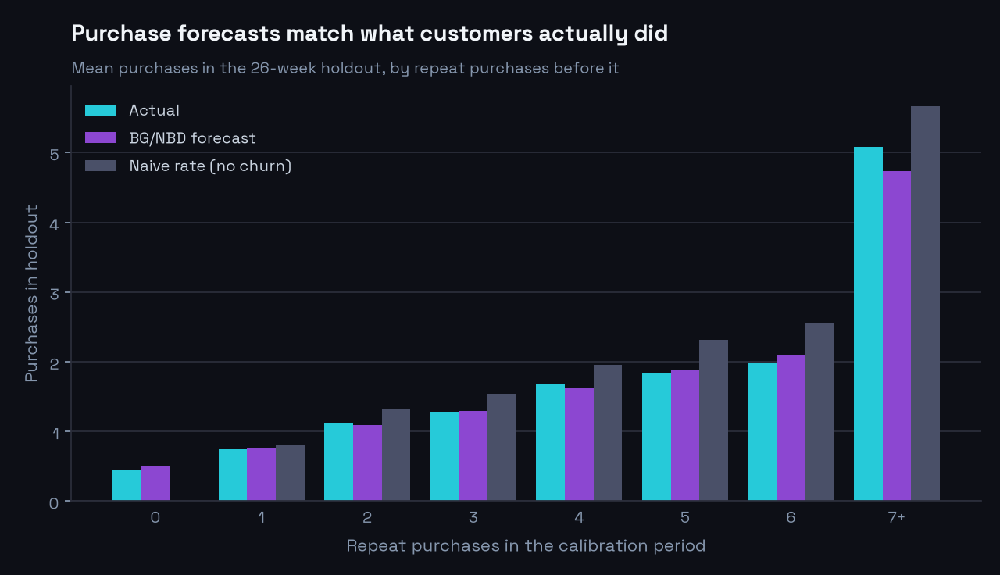
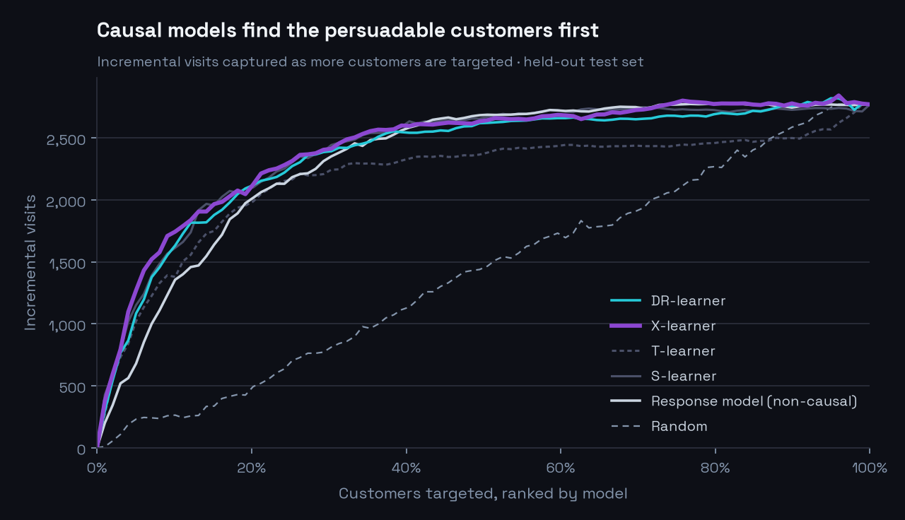
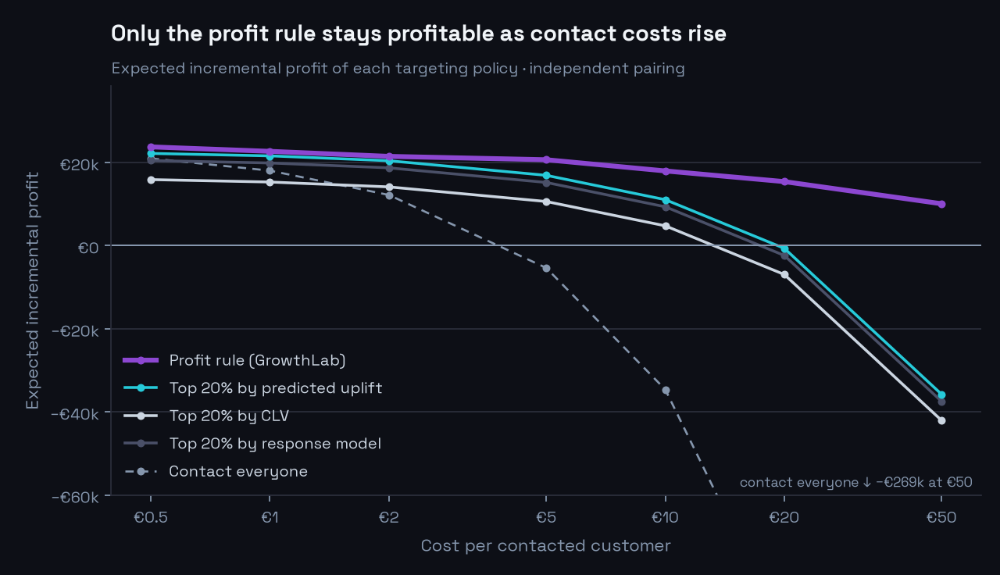

# 🧪 GrowthLab — CLV & Causal Uplift Decision Engine

> **TL;DR** — Targeting a retention incentive by *expected incremental profit*
> (margin × CLV × causal uplift − cost) earned **€21.5k** in simulation, versus **€11.9k** for
> the classic "top 20 % by CLV" list, while contacting **half as many customers**. It is the only
> policy that stays profitable as contact costs rise. Every number below was measured on
> held-out data; the limitations are listed alongside the results.

## The business problem

Retention campaigns usually target the customers *most likely to churn* or *most valuable*. Both
are the wrong question. What matters is **who changes their behaviour because of the campaign**:

| Segment | Without incentive | With incentive | Action |
|---|---|---|---|
| **Persuadables** | leave | stay | ✅ target |
| **Sure Things** | stay | stay | ❌ wasted budget |
| **Lost Causes** | leave | leave | ❌ wasted budget |
| **Sleeping Dogs** | stay | leave | ⛔ never contact |

GrowthLab combines **how much a customer is worth** (CLV) with **how much the incentive changes
their behaviour** (causal uplift) to decide who should receive it.

## Approach

1. **Probabilistic CLV** — BG/NBD (purchase frequency) + Gamma-Gamma (spend), with a temporal
   calibration/holdout split. _Data: Online Retail II._
2. **Causal uplift** — heterogeneous treatment effects (CATE) with meta-learners, evaluated with
   Qini curves and top-k uplift. _Data: Criteo Uplift (randomized experiment)._
3. **Decision engine** — expected incremental value = CLV × uplift − incentive cost.
4. **Serving** — FastAPI `/decide-action` endpoint and a Streamlit demo.

### A note on the data

The two public datasets do not share customers: no public dataset contains both long purchase
histories *and* a randomized retention experiment. Each module is therefore trained and evaluated
on its own dataset, and the decision engine is demonstrated on a documented simulation that
combines the two. The assumptions behind that simulation are stated explicitly.

## Results

### Module 1 — Probabilistic CLV ✅

**Setup.** 5,852 customers, 36,594 invoices (Dec 2009 – Dec 2011) after cleaning
([cleaning log](reports/clv/cleaning_log.csv): cancellations, missing IDs, postage/fee lines and
duplicates removed — 27 % of raw lines). Models are fitted on the calibration period
(until 2011-06-09) and evaluated on what customers *actually* did in the following 26 weeks.
Baseline: each customer keeps buying at their historical rate, with no churn.

| Holdout (26 weeks, 4,941 customers) | BG/NBD + Gamma-Gamma | Naive rate |
|---|---|---|
| Total purchases, error | **−2.5 %** | +3.7 % |
| Purchases per customer, MAE | **1.04** | 1.08 |
| Purchases, rank correlation (Spearman) | **0.62** | 0.58 |
| Total revenue, error | **−16 %** | −21 % |
| Revenue held by top-20 % ranked customers | **76.2 %** | 75.4 % (past spend) |



**What this tells us**

- **Purchase frequency is well calibrated** across every customer segment, including one-time
  buyers. The naive rate systematically overestimates loyal customers because it ignores churn.
- **Revenue is under-predicted by 16 %.** Purchase counts are almost exact, so the gap comes from
  spend: the average order in the holdout was 10 % higher than in calibration (€499 vs €453,
  driven by Aug–Oct 2011). Gamma-Gamma assumes spend per order is stable over time — a known
  limitation for seasonal businesses. Its other assumption, that spend is independent of
  frequency, holds (correlation 0.08).
- **For ranking, the gain over "past spend" is small** (+0.9 pp of revenue in the top 20 %).
  The value of the model here is not a better top-N list but *calibrated, per-customer
  forecasts* — which is what the decision engine needs to turn uplift into expected profit.

**Known limitations**

- BG/NBD treats customers with no repeat purchase as certainly alive (`p_alive = 1`), which
  inflates their retention probability. MBG/NBD or Pareto/NBD would address this.
- Online Retail II is largely wholesale: a few very large accounts dominate revenue, so error
  metrics in € are driven by a small number of customers.
- No seasonality or covariates; a production version would add them or recalibrate monthly.

Output: `data/processed/clv_scores.parquet` — per customer `p_alive`, expected purchases and
spend, and 12-month discounted CLV, from models refitted on the full history.

### Module 2 — Causal uplift ✅

**Setup.** Criteo Uplift is a randomized experiment (85 % treated / 15 % control), so treated vs
control outcomes within any group of customers are an unbiased estimate of the causal effect.
Random 1M-row sample, 70/30 train/test split stratified by treatment × outcome.
Outcome: **site visit** (conversions are too rare — 296 in the control group — to estimate
individual effects). `exposure` is excluded from the features: it only exists after treatment,
so using it would leak the outcome.

Average effect of the campaign on the test set: **+1.09 pp** visits (3.77 % → 4.86 %,
95 % CI ± 0.20 pp).

| Model (test set, 300k customers) | Qini coefficient | Uplift in top 10 % | Uplift in top 30 % |
|---|---|---|---|
| Random targeting | 0.01 | +0.99 pp | +1.05 pp |
| Response model (non-causal) | 0.34 | +5.17 pp | +3.05 pp |
| S-learner | 0.37 | +6.16 pp | +3.12 pp |
| T-learner | 0.29 | +5.31 pp | +2.91 pp |
| **X-learner** | **0.37** | **+6.75 pp** | +3.14 pp |
| DR-learner | 0.35 | +6.26 pp | +3.14 pp |



**What this tells us**

- **The campaign's effect is highly concentrated.** Targeting ~40 % of customers already
  captures almost all the incremental visits; the other 60 % add cost and nearly nothing else.
- **A plain response model is a strong baseline here.** On Criteo, the customers most likely to
  visit are also the most persuadable, so "who will respond?" and "who will respond *because of
  us*?" overlap. Over the whole ranking, the X-learner is not significantly better (Qini
  +0.03, bootstrap 95 % CI −0.03 to +0.09).
- **Where it matters, causal modelling wins.** For a tight budget (top 10 %), the X-learner's
  customers show **+1.5 pp more uplift** than the response model's
  (95 % CI +0.4 to +2.6 pp) — about 30 % more incremental visits for the same spend.
- **The T-learner is the weakest causal model**: it fits the control group (only 15 % of the
  data) on its own, so its difference of two noisy models is noisy. X- and DR-learners are
  designed for exactly this imbalance.

**Segments** (thresholds on X-learner predictions, checked against observed outcomes):

| Segment | Share | Treated | Control | Observed uplift |
|---|---|---|---|---|
| Persuadables | 20 % | 18.8 % | 14.7 % | **+4.1 pp** ± 0.8 |
| Sure Things | 29 % | 1.4 % | 1.0 % | +0.4 pp ± 0.2 |
| Lost Causes | 29 % | 0.05 % | 0.03 % | +0.02 pp ± 0.03 |
| Sleeping Dogs | 22 % | 3.3 % | 3.3 % | −0.04 pp ± 0.4 |

One honest finding: the "Sleeping Dogs" the model flags (predicted negative effect) show **no
effect at all**, not a negative one — there is no evidence that this campaign drives anyone
away. They should still not be targeted, since contacting them costs money and gains nothing.

**Known limitations**

- The best model is chosen and reported on the same test set; with six candidates this
  slightly flatters the winner. The pre-specified comparison (best causal vs response model) is
  bootstrapped to account for sampling noise.
- Criteo features are anonymised, so effects cannot be explained in business terms.
- Results are on a 1M sample; `make data` fetches the full 14M rows.

### Module 3 — Decision engine ✅

**The rule.** Send the incentive only when

> expected incremental profit = margin × CLV × uplift − cost > 0

with a 30 % gross margin and €5 per contacted customer (incentive + contact) as defaults.

**Bridging the two datasets.** Each of the 5,852 Online Retail customers (real CLV) is paired
with a Criteo test-set user (predicted uplift *and* a real randomised outcome). Because the true
relationship between value and persuadability is unknown, two pairings bracket it:

- **independent** — value and persuadability are unrelated;
- **aligned** — the most active buyers are also the most responsive users.

Assumption: responding to the campaign retains the customer's 12-month CLV. CLV is capped at the
99.5th percentile (€22.8k) so that a few wholesale accounts do not dominate the totals.

**Honest evaluation.** Policies are *not* scored with the model's own uplift predictions —
that would reward a model for believing itself. Each targeted customer contributes
margin × CLV × z − cost, where z = y·(t/p − (1−t)/(1−p)) is the *transformed outcome* of the
paired Criteo user: its expectation equals the true individual uplift because treatment was
randomised. Results are averaged over 200 random pairings; differences are paired.

| Policy (independent pairing) | Contacted | Expected profit | vs GrowthLab |
|---|---|---|---|
| Contact nobody | 0 | €0 | −€21.5k ± 1.9k |
| Contact everyone | 5,852 | −€3.4k | −€24.9k ± 1.1k |
| Top 20 % by CLV | 1,171 | €11.9k | −€9.6k ± 1.1k |
| Top 20 % by response model | 1,171 | €18.0k | −€3.5k ± 1.1k |
| Top 20 % by predicted uplift | 1,171 | €18.0k | −€3.5k ± 0.4k |
| Top 20 % by expected profit | 1,171 | €19.8k | −€1.7k ± 0.4k |
| **GrowthLab: profit > 0** | **597** | **€21.5k** | — |

_± = one standard error of the mean over 200 pairings._

With **aligned** pairing every policy earns more (high-value customers are also persuadable),
and GrowthLab (€89.0k, 842 contacted) ties with "top 20 % by expected profit" (€88.9k) and is
within noise of the response model (−€2.2k ± 2.0k). It still beats CLV-only targeting
(−€4.8k ± 2.1k) and contacting everyone (−€24.0k ± 2.1k).



**What this tells us**

- **Value alone is the wrong target.** Ranking by CLV contacts customers who would have stayed
  anyway; it earns about half of what GrowthLab earns under independent pairing.
- **Fixed-size lists ignore economics.** "Top 20 %" contacts 1,171 customers whatever the cost.
  The profit rule adapts — it contacts fewer people as costs rise and is the only policy that is
  still profitable at €20–50 per contact.
- **When value and persuadability coincide, simple rules catch up.** Under aligned pairing a
  response model is nearly as good. The causal + value combination matters most exactly when
  the two signals disagree — which is the case to prepare for.

**Known limitations**

- The bridge between datasets is simulated; the "retained = 12-month CLV" mapping is an
  assumption. In production, both would be measured on the same customers through a
  randomised hold-out group in the retention campaign itself.
- Margin and cost are illustrative defaults; the demo lets you change them.

### Serving

- **API** (`make api`, docs at `/docs`): `POST /decide-action` scores a customer from their
  purchase history and campaign features and returns the action, expected profit, CLV,
  uplift and segment; `GET /customers/{id}` returns the precomputed decision. Single-request
  latency is ~0.65 s, dominated by pymc-marketing's CLV computation — a production version
  would cache the posterior means and evaluate the closed-form expressions in NumPy.
- **Demo** (`make demo`): change margin, cost and pairing and see how each policy's profit
  and the per-customer decisions respond.

## Quickstart

Requires [uv](https://docs.astral.sh/uv/).

```bash
make install       # create .venv from uv.lock
make data-sample   # Online Retail II + random 1M-row Criteo sample
make clv           # Module 1: train, evaluate on holdout, score customers (~1 min)
make uplift        # Module 2: fit and compare uplift models (~4 min)
make decision      # Module 3: simulate policies, write decisions (seconds)
make test          # 26 tests, including API and demo end-to-end
make demo          # interactive demo  ·  make api  ·  make mlflow
```

Run `make help` for all commands.

## Project structure

```
src/growthlab/
├── data/        # download & preprocessing
├── clv/         # BG/NBD + Gamma-Gamma
├── uplift/      # meta-learners, Qini curves, segments
├── decision/    # profit rule + policy simulation
├── api/         # FastAPI service
└── demo.py      # Streamlit app
reports/         # metrics, tables and figures used in this README
tests/
```

## Data sources & licences

- **Online Retail II** — Chen, D. (2019), UCI Machine Learning Repository, CC BY 4.0.
- **Criteo Uplift Prediction Dataset v2.1** — Diemert et al. (2018), Criteo AI Lab, CC BY-NC-SA 4.0.

Data is downloaded by `make data` and is not redistributed in this repository.

## License

MIT
